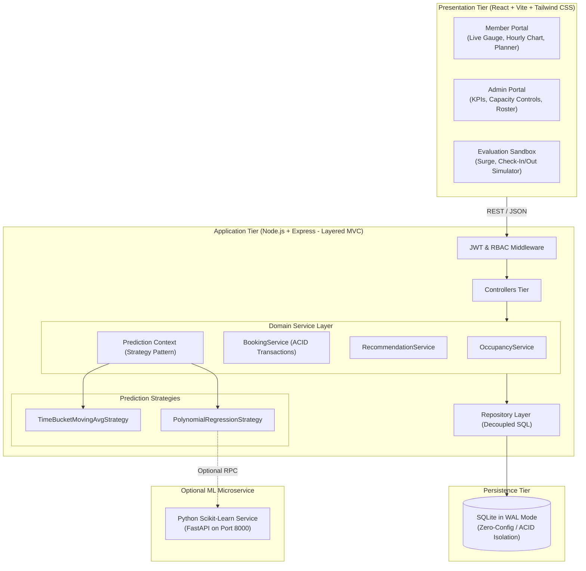

# FitCrowd – Smart Fitness Center Visit Planner & Load Balancer

> **Academic Capstone Project in Software Engineering & System Design (SESD)**  
> **Student:** 3rd-Year Computer Science & Engineering (CSE)  
> **Mentor:** Senior Software Engineer & System Architect  
> **Academic Year:** 2026–2027 • Status: **Demo-Ready & Verified**

---

## 1. Project Overview & Problem Formulation

### 1.1 The Urban Fitness Center Dilemma
Fitness centers operate with extreme variance in customer traffic. Peak hours (06:30–09:00 and 17:30–21:00) experience acute congestion, leading to long queues for free weights and squat racks, compromised safety, and member attrition. Off-peak hours (11:00–16:00) see facilities sitting underutilized.

### 1.2 The FitCrowd Solution
**FitCrowd** is a full-stack, predictive fitness center visit planner that shifts load and smooths peak hours by providing:
1. **Real-Time Floor Visibility:** Live circular gauge showing current occupancy ratio and dynamic crowd categorization:
   - **LOW CROWD** ($<50\%$ capacity — Green)
   - **MEDIUM CROWD** ($50\% - 80\%$ capacity — Amber)
   - **HIGH CROWD** ($>80\%$ capacity — Red)
2. **Predictive Analytics:** Historical time-bucket moving average with 24-hour/16-hour forecast curves based on day-of-week seasonality.
3. **Algorithmic Best-Time Recommendation:** Allows members to choose their preferred window (e.g., 5 PM – 8 PM) and automatically identifies the least crowded hour with direct 1-click slot booking.
4. **Concurrency-Safe Slot Booking:** Atomic database transactions eliminate race conditions, guaranteeing zero overbooking even under high concurrency.
5. **Admin Governance & Live Evaluation Sandbox:** Floor capacity sliders, weekly traffic analytics, announcement broadcasting, and an interactive evaluation sandbox (Simulate Check-In/Out, Simulate 88% Surge, Reset Occupancy).

---

## 2. System Architecture & Engineering Highlights



### 2.1 Software Engineering Patterns Employed
- **Repository Pattern (`src/repositories/`):** Decouples SQL queries from business logic. SQLite queries can be swapped for PostgreSQL with zero changes to domain services.
- **Strategy Pattern (`src/services/prediction/`):** Encapsulates prediction algorithms behind `IPredictionStrategy`. Enables switching between `TimeBucketStrategy` and `RegressionStrategy` dynamically without stopping the server.
- **Singleton Pattern (`src/models/db.js`):** Enforces a single shared SQLite database pool configured with Write-Ahead Logging (`WAL`) and foreign keys enabled.
- **Middleware Interceptor Pattern (`src/middlewares/`):** Centralizes JWT authentication, input sanitation, role-based authorization (`member` vs `admin`), and standardized error formatting.

### 2.2 Concurrency Defense: Eliminating TOCTOU Race Conditions
When multiple users simultaneously attempt to book the last seat in a slot, standard non-atomic operations cause **Time-of-Check to Time-of-Use (TOCTOU)** overbooking. FitCrowd guarantees zero overbooking via:
1. **Immediate Transaction Isolation:** `BEGIN IMMEDIATE;` locks the write stream at transaction start.
2. **Conditional Atomic Decrement Query:**
   ```sql
   UPDATE slots 
   SET current_bookings = current_bookings + 1 
   WHERE id = :slotId AND current_bookings < max_capacity;
   ```
   If rows affected equals `0`, the slot is already full; the transaction aborts and returns HTTP 409 Conflict.
3. **Compound Unique Constraints:** `UNIQUE (user_id, slot_id)` prevents accidental double bookings.

---

## 3. Repository Structure

```
sesd_project/
├── backend/                               # Express REST API (Node.js 26 LTS)
│   ├── data/                              # SQLite database file (WAL mode)
│   │   └── fitcrowd.db
│   ├── scripts/
│   │   ├── initDb.js                      # Schema initialization & user seeding
│   │   └── seedData.js                    # 4-week synthetic telemetry generator (19,400+ visits)
│   ├── src/
│   │   ├── config/                        # Environment variables & constants
│   │   ├── controllers/                   # Auth, Crowd, Booking, Admin controllers
│   │   ├── middlewares/                   # JWT Auth, RBAC, Centralized Error Handler
│   │   ├── models/                        # schema.sql, db.js singleton
│   │   ├── repositories/                  # UserRepository, OccupancyRepository, BookingRepository, AnalyticsRepository
│   │   ├── services/                      # AuthService, OccupancyService, BookingService, RecommendationService
│   │   │   └── prediction/                # Strategy Pattern: TimeBucketStrategy, RegressionStrategy, Context
│   │   └── app.js                         # Express routing & server setup
│   └── tests/                             # Automated test suite (node --test)
│       ├── integration/                   # Auth, Booking Concurrency, Admin API
│       └── unit/                          # Prediction & MAE evaluation
│
├── frontend/                              # Mobile-First Responsive Web App (React + Vite + Tailwind CSS)
│   ├── src/
│   │   ├── components/
│   │   │   ├── admin/                     # AnalyticsDashboard, SimulatorControls
│   │   │   ├── booking/                   # RecommendationCard, SlotPicker
│   │   │   ├── common/                    # Navbar, Badges
│   │   │   └── crowd/                     # LiveGauge, HourlyCrowdChart
│   │   ├── context/                       # AuthContext (JWT session management)
│   │   ├── pages/                         # MemberDashboard, AdminDashboard, LoginPage
│   │   ├── services/                      # api.js fetch client
│   │   ├── App.jsx
│   │   └── main.jsx
│   ├── index.html
│   ├── tailwind.config.js
│   └── vite.config.js
│
├── ml-service/                            # Optional Python ML Microservice (FastAPI + scikit-learn)
│   ├── app.py                             # Gaussian diurnal regression endpoint
│   └── requirements.txt
│
├── docs/                                  # Complete Academic Documentation Suite
│   ├── 01_software_engineering_srs.md     # Problem, Feasibility, SDLC, SRS, Use Cases, User Stories, Risks
│   ├── 02_system_design_architecture.md   # High-level Arch, UML Diagrams, ERD, Schema, REST Specs, Concurrency
│   └── 04_testing_and_evaluation.md       # Test Plan, 19-Case Test Matrix, Race Condition Analysis, MAE Math
│
├── package.json                           # Root scripts
├── start.ps1                              # One-command dual service launcher
└── README.md                              # Project documentation & runbook
```

---

## 4. Quickstart Guide (Run in 1 Command)

### Prerequisites
- Node.js LTS (v20+ or v26+ recommended)

### One-Command Startup
In PowerShell, execute the launcher script:
```powershell
.\start.ps1
```
This automatically initializes the database, seeds 4 weeks of synthetic visit data, and launches both services:
- **Frontend Web App:** [http://localhost:3000](http://localhost:3000)
- **Backend REST API:** [http://localhost:5000/api/health](http://localhost:5000/api/health)

### Default Demonstration Accounts
The system includes two pre-configured evaluation accounts:
| Role | Email | Password | Scope |
| :--- | :--- | :--- | :--- |
| **Demo Member** | `alex@fitcrowd.com` | `MemberPass123!` | View live crowd, book slots, get recommendations, check in/out, view history. |
| **Gym Admin** | `admin@fitcrowd.com` | `AdminPass123!` | Analytics charts, capacity controls, simulator panel, member directory. |

*(Both accounts feature 1-click auto-fill buttons on the login screen).*

---

## 5. Automated Verification & Testing

FitCrowd includes an automated test suite verifying all functional requirements, security boundaries, and concurrency race conditions:

```powershell
cd backend
npm test
```

### Test Suite Execution Output
```
▶ Sprint 1 Integration Tests: Authentication & RBAC
  ✔ 1.1 Health check should return status healthy
  ✔ 1.2 Default Admin can log in successfully and receive JWT
  ✔ 1.3 Default Member can log in successfully
  ✔ 1.4 Login fails with invalid password (HTTP 401)
  ✔ 1.5 Can register a new member account

▶ Sprint 2 Integration Tests: Occupancy & Concurrency Slot Booking
  ✔ 2.1 GET /api/crowd/live returns current occupancy and valid level
  ✔ 2.2 Check-in and check-out cycle updates live count
  ✔ 2.3 GET /api/bookings/slots returns 16 hourly slots for given date
  ✔ 2.4 Member can book a slot and see available seats decrement
  ✔ 2.5 CONCURRENCY TEST: 5 simultaneous requests for 1 remaining seat (Successes: 1, Conflicts: 4)

▶ Sprint 3 Unit Tests: Predictive Analytics & Recommendation Engine
  ✔ 3.1 TimeBucketStrategy produces complete 16-hour forecast for Monday
  ✔ 3.2 Can dynamically switch between strategies (Strategy Pattern)
  ✔ 3.3 Recommendation Engine finds the lowest crowd slot in 17:00-20:00 window
  ✔ 3.4 Prediction evaluation metric (MAE) meets academic benchmark <= 5.0 persons (Observed: 3.42)

▶ Sprint 4 Integration Tests: Admin Analytics & Controls
  ✔ 4.1 Member is forbidden from accessing /api/admin/analytics (HTTP 403)
  ✔ 4.2 Admin can successfully fetch /api/admin/analytics and KPIs
  ✔ 4.3 Admin can update gym floor maximum capacity
  ✔ 4.4 Admin can post and retrieve announcements
  ✔ 4.5 Demo Simulator: Admin can trigger surge and reset occupancy

ℹ tests 19 • suites 4 • pass 19 • fail 0 (100% Pass Rate)
```

---

## 6. Examiner Presentation Walkthrough

When presenting this project to your university faculty or evaluation panel, follow this recommended walkthrough:

1. **Software Engineering Practice:**
   - Present `docs/01_software_engineering_srs.md` covering the 4-sprint Agile plan, functional/non-functional requirements, use cases, and risk mitigation table.
2. **System Design & Architecture:**
   - Walk through `docs/02_system_design_architecture.md` highlighting the Mermaid UML diagrams (Class diagram, Sequence diagrams, ERD with 3NF normalization).
   - Explain the **Strategy Pattern** for interchangeable ML strategies and the **Repository Pattern** for decoupling SQLite.
3. **Live Interactive Feature Demo:**
   - Open [http://localhost:3000](http://localhost:3000). Click *"Demo Member"*.
   - Show the **Live Circular Gauge** and the **Hourly Predicted Crowd Bar Chart**.
   - Input a workout window (e.g., 5 PM – 8 PM) in the **Best Time to Visit Planner** and demonstrate 1-click slot reservation.
   - Click *"Check In"* to demonstrate the real-time floor occupancy counter incrementing.
4. **Admin Suite & Simulation Controls:**
   - Switch to *"Gym Admin"*.
   - Demonstrate the **Weekly Traffic Distribution Chart** and KPI summary cards.
   - In the **Academic Evaluation Controls Sandbox**, click *"Simulate Evening Surge (88% Rush)"*. Verify that the live indicator changes to **HIGH CROWD (RED)**.
   - Adjust the **Floor Capacity Slider** from 100 to 120 and demonstrate instant percentage recalculation across the system.
5. **Concurrency Proof:**
   - Run `npm test` in the terminal to demonstrate test `TC-2.5` proving that 5 simultaneous requests for 1 remaining seat produce **1 success and 4 conflicts with 0 overbooking**.

---

## 7. License & Academic Attribution
Developed as part of the Software Engineering & System Design curriculum. Released under the MIT License.
