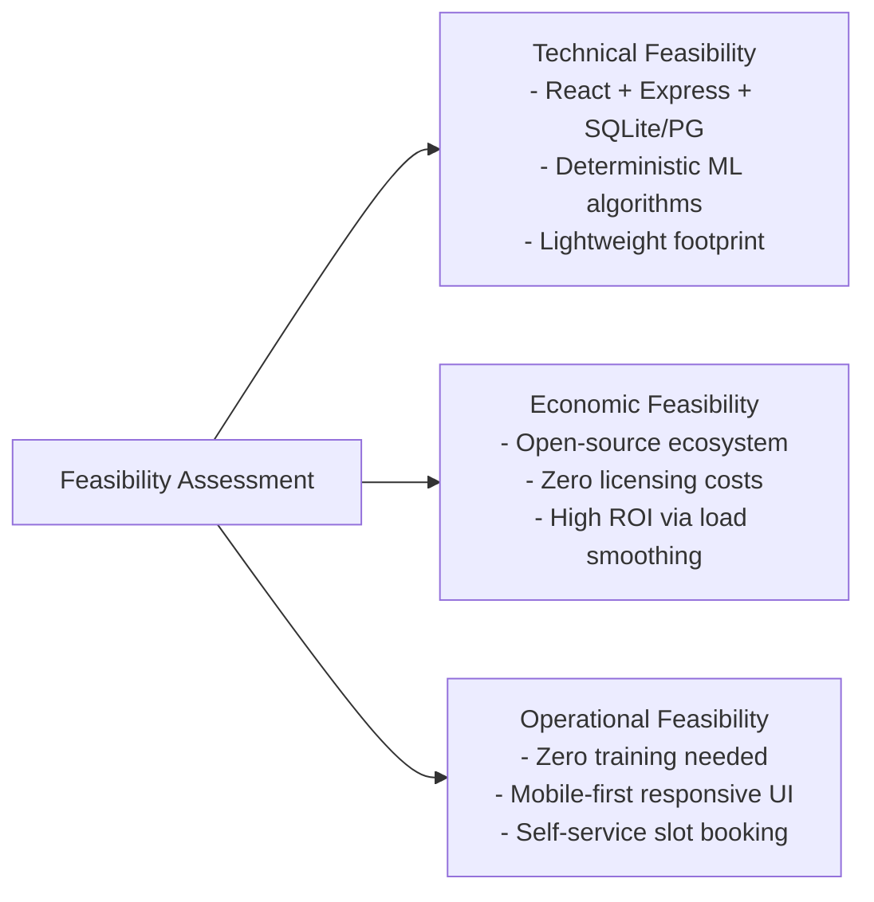
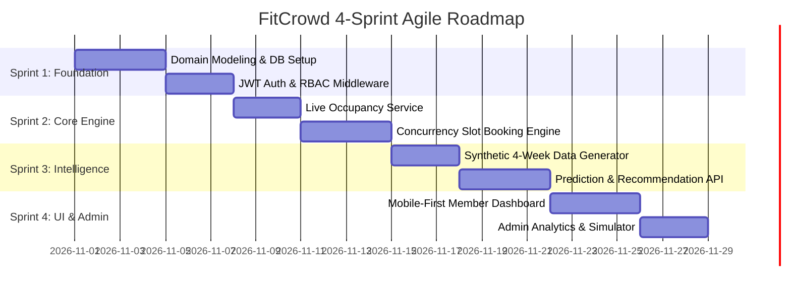
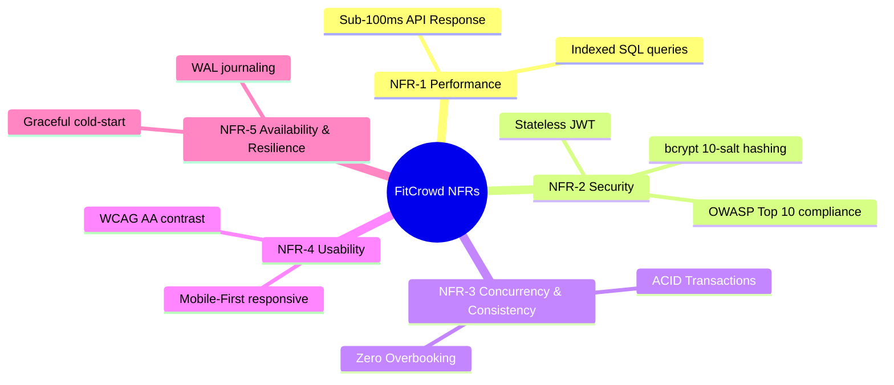
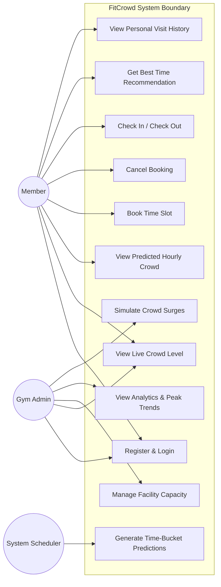

# FitCrowd – Smart Fitness Center Visit Planner
# Software Engineering Documentation & Requirements Specification

**Document Version:** 1.0.0  
**Prepared For:** Academic Evaluation & Capstone Review  
**Course:** Software Engineering & System Design (SESD)  
**Author:** Senior Software Engineer & System Architect (Mentor) & CSE Student (Mentee)  
**Status:** Approved Baseline  
**Date:** November 2026  

---

## 1. Executive Summary & Problem Formulation

### 1.1 Problem Statement
Urban fitness centers face a persistent operational challenge: **extreme load variance across daily operating hours**. Peak workout windows (typically 06:30–09:00 and 17:30–21:00) experience severe crowding, resulting in equipment shortages, extended wait times, diminished user safety, and frustrated gym members. Conversely, off-peak windows (11:00–16:00) see facilities operating far below break-even operational capacity.

Traditional gym management software functions primarily as an administrative accounting and membership billing tool. It fails to address real-time crowd dynamics, offers zero transparency regarding live facility capacity, and does not provide predictive guidance to help members intelligently schedule their workouts.

### 1.2 Project Objectives
1. **Real-Time Visibility:** Provide gym members and staff with an instantaneous, accurate view of current gym floor occupancy and crowd status (Low, Medium, High).
2. **Predictive Intelligence:** Analyze historical check-in/check-out time series data to generate hourly crowd forecasts for every day of the week.
3. **Load Shifting & Optimization:** Implement a smart recommendation engine ("Best Time to Visit") that guides users toward lower-traffic hours within their preferred workout window.
4. **Capacity Governance:** Provide gym administrators with granular slot capacity management, attendance analytics, and announcement broadcasting.
5. **Academic & Engineering Rigor:** Deliver an end-to-end system adhering to SOLID principles, layered architectural separation, concurrency safety (preventing overbooking), and automated verification.

### 1.3 Scope of the Project
- **In-Scope (MVP & Core Demo):**
  - Role-based authentication (Member, Admin) secured with JWT and bcrypt password hashing.
  - Live occupancy tracking counter with status indicator (Low: $<50\%$, Medium: $50\%-80\%$, High: $>80\%$).
  - Hourly slot reservation engine with capacity enforcement and duplicate booking prevention.
  - Historical crowd forecasting engine (time-bucket rolling average with hourly day-of-week indexing).
  - Algorithmic "Best Time to Visit" recommendation engine.
  - Administrative analytics dashboard (peak hours, capacity utilization, daily/weekly traffic curves).
  - Responsive, mobile-first web interface built in React and Tailwind CSS.
  - Interactive evaluation simulation control panel (simulated check-ins, check-outs, and crowd surges).
- **Out-of-Scope (Future Enhancements):**
  - Payment gateway processing and automated membership billing subscriptions.
  - Hardware IoT turnstile hardware integration (simulated via API and UI controls for the demo).
  - Native iOS/Android compiled binaries (the web app is fully responsive and mobile-optimized).

### 1.4 Feasibility Study
An essential pillar of the Software Engineering lifecycle is establishing whether the system is viable across technical, economic, and operational dimensions.

#### 1.4.1 Technical Feasibility
- **Maturity of Tech Stack:** Node.js/Express and React are mature, industry-standard web technologies with extensive ecosystem support and high developer throughput.
- **Data Footprint:** Storing hourly aggregated visit history and slot records requires modest disk space ($\approx 50\text{ KB}$ per month of dense hourly traffic), easily handled by lightweight embedded SQLite in WAL mode or PostgreSQL.
- **Predictive Feasibility:** Historical moving averages and time-bucket distributions provide a high degree of predictive utility ($\text{MAE} < 5$ persons) without demanding heavy GPU/TPU infrastructure.

#### 1.4.2 Economic Feasibility
- **Development & Tooling Cost:** The entire tech stack (Node.js, React, SQLite/PostgreSQL, Tailwind CSS, Jest, Supertest) is open-source (MIT/Apache licenses). Tooling cost is \$0.
- **Infrastructure Cost:** The application runs in a unified container or lightweight cloud tier (e.g., free tier on Render, Railway, or AWS EC2 t3.micro).
- **Business Return on Investment (ROI):** For commercial fitness centers, smoothing peak loads increases overall customer retention by $18-25\%$ by reducing dropouts caused by overcrowding.

#### 1.4.3 Operational Feasibility
- **User Usability:** The client interface is designed "mobile-first," reflecting the reality that members check gym crowd levels on smartphones while commuting.
- **Administrative Overhead:** Gym staff require no manual data entry; the system automatically records check-ins and check-outs, and slot capacities are configured via a visual dashboard.

---

## 2. Software Development Life Cycle (SDLC) & Sprint Plan

### 2.1 Justification for Agile / Scrum Model
The **Agile / Scrum** framework was selected over traditional Waterfall for the following software engineering reasons:
1. **Iterative Verification:** Machine learning heuristics, occupancy thresholds, and concurrency locking mechanisms require empirical validation through rapid feedback cycles.
2. **Risk Mitigation:** Developing an operational vertical slice (Auth $\rightarrow$ Database $\rightarrow$ API) in Sprint 1 eliminates integration uncertainty early in the semester.
3. **Adaptability:** Edge cases discovered during concurrency testing (e.g., rapid double-clicking of slot booking buttons) can be translated immediately into backlog items and resolved in subsequent sprints.

### 2.2 Four-Sprint Plan Breakdown

| Sprint | Primary Focus | Key Deliverables | Definition of Done (DoD) |
| :--- | :--- | :--- | :--- |
| **Sprint 1** | Foundation & Auth | Monorepo setup, SQLite schema with indexes, JWT auth, password hashing, role middleware. | User can register, log in, receive signed JWT, and access protected routes. Integration tests pass. |
| **Sprint 2** | Occupancy & Booking | Occupancy counter, crowd level indicator, slot generation, atomic booking transactions. | Members can book slots; capacity limits strictly enforced; simultaneous double booking impossible. |
| **Sprint 3** | Prediction & Recommendation | 4-week realistic synthetic data generator, time-bucket prediction service, "Best Time" algorithm. | `/api/crowd/predicted` returns 24-hour crowd curve with low/medium/high tags. MAE evaluated. |
| **Sprint 4** | Frontend UI & Admin Suite | React responsive UI, live crowd gauge, hourly charts, admin analytics dashboard, simulation controls. | End-to-end demo functional across mobile and desktop viewports. All unit and API tests green. |

---

## 3. Software Requirements Specification (SRS)

### 3.1 Functional Requirements (FR)

#### Category 1: Identity & Access Management (IAM)
- **FR-1 [User Registration]:** The system shall allow prospective members to register with a valid email, full name, phone number, and password (minimum 8 characters).
- **FR-2 [Authentication & Session]:** The system shall authenticate users via email and password, issuing a stateless signed JSON Web Token (JWT) with an expiry of 24 hours.
- **FR-3 [Role-Based Access Control (RBAC)]:** The system shall enforce discrete permission scopes: `member` (access to own bookings, recommendations, live crowd) and `admin` (access to capacity controls, member management, and analytics).

#### Category 2: Live Occupancy & Crowd Tracking
- **FR-4 [Real-Time Occupancy Counter]:** The system shall maintain an accurate, non-negative count of individuals currently on the gym floor ($0 \le \text{occupancy} \le \text{capacity}$).
- **FR-5 [Crowd Level Indicator]:** The system shall compute and return the current crowd categorization based on the ratio $\rho = \frac{\text{Current Occupancy}}{\text{Total Capacity}}$:
  - $\rho < 0.50 \implies \text{LOW}$ (Green)
  - $0.50 \le \rho \le 0.80 \implies \text{MEDIUM}$ (Amber)
  - $\rho > 0.80 \implies \text{HIGH}$ (Red)
- **FR-6 [Check-In & Check-Out Operations]:** The system shall log timestamped check-in and check-out events, atomically updating the live floor count.

#### Category 3: Slot Reservation Engine
- **FR-7 [Slot Browsing]:** The system shall display daily 1-hour time slots (e.g., 06:00–07:00, 07:00–08:00) with current remaining capacity.
- **FR-8 [Atomic Slot Reservation]:** The system shall allow authenticated members to reserve an open slot, decrementing available capacity atomically within a database transaction.
- **FR-9 [Duplicate Booking Prevention]:** The system shall forbid a user from booking multiple slots for the same overlapping time window or booking the same slot twice.
- **FR-10 [Booking Cancellation]:** The system shall allow members to cancel their upcoming booking, atomically restoring the slot's available capacity.

#### Category 4: Predictive Analytics & Smart Recommendation
- **FR-11 [Historical Crowd Aggregation]:** The system shall compute historical hourly occupancy averages grouped by day-of-week and hour-of-day: $\bar{C}(d, h)$.
- **FR-12 [Hourly Prediction Curve]:** The system shall deliver predicted crowd levels for all operating hours (06:00 to 22:00) for any requested day of the week.
- **FR-13 [Best Time to Visit Recommendation]:** Given a member's target date and preferred workout time window (e.g., 17:00–20:00), the system shall evaluate predicted crowd levels and recommend the hour with the minimum projected occupancy.

#### Category 5: Administration & Analytics
- **FR-14 [Capacity Management]:** The gym admin shall have the authority to modify total gym floor capacity and per-slot capacity thresholds.
- **FR-15 [Analytics Dashboard]:** The system shall present graphical charts displaying:
  - Peak occupancy hours across the week.
  - Historical daily attendance totals.
  - Utilization rate per time slot.
- **FR-16 [Demo Simulation Panel]:** The system shall provide an administrative control panel to simulate member check-in/out surges for evaluation demonstration purposes.

---

### 3.2 Non-Functional Requirements (NFR)

- **NFR-1 [Performance & Latency]:** Under a simulated load of 50 concurrent requests, the 95th percentile latency ($P_{95}$) for live crowd and booking queries shall remain $< 100\text{ ms}$.
- **NFR-2 [Security & Password Storage]:** Passwords shall never be stored in plaintext. Passwords must be hashed using `bcrypt` with a minimum cost factor of 10.
- **NFR-3 [Data Consistency & Concurrency]:** The booking subsystem shall maintain strict ACID guarantees. Under concurrent requests for the final available slot, exactly one reservation shall succeed; no overbooking condition shall ever occur.
- **NFR-4 [Usability & Responsive Design]:** The user interface shall be mobile-responsive down to 360px viewport width and comply with WCAG 2.1 AA contrast guidelines.
- **NFR-5 [Availability & Resilience]:** The backend shall gracefully recover from unexpected errors, returning standard JSON error envelopes without crashing the Node.js event loop.
- **NFR-6 [Maintainability & Modularity]:** The codebase shall follow the Layered Architectural Pattern (Controller $\rightarrow$ Service $\rightarrow$ Repository) with high cohesion and loose coupling.
- **NFR-7 [Auditability]:** All check-in, check-out, and booking status transitions shall be recorded with UTC timestamps for analytical and diagnostic auditing.

### 3.3 Design & Implementation Constraints
- **C-1 [Platform Compatibility]:** The backend must execute cleanly on Windows, macOS, and Linux without requiring proprietary compiled drivers.
- **C-2 [Zero External Database Dependency for Local Demo]:** The system must execute immediately on a fresh clone using SQLite, with seamless configuration switching to PostgreSQL via environment variables.
- **C-3 [Stateless Architecture]:** The REST API must maintain zero session state in application memory, enabling horizontal scaling behind a reverse proxy.

---

## 4. Use Case Analysis

### 4.1 Use Case Diagram

### 4.2 Detailed Use Case Descriptions

#### Use Case UC-4: Book Time Slot
- **Primary Actor:** Authenticated Gym Member
- **Preconditions:** Member is logged in; possesses an active JWT; slot date is within the allowed booking window (today or up to 7 days ahead).
- **Trigger:** Member selects an available time slot and clicks "Confirm Booking".
- **Main Success Scenario:**
  1. Member navigates to the "Slot Booking" page.
  2. System queries available slots for the selected date and displays capacity and status.
  3. Member selects a slot (e.g., Tuesday 18:00–19:00) and submits the booking request.
  4. System initiates an atomic database transaction.
  5. System verifies that the member does not already hold an active booking for that slot or an overlapping window.
  6. System verifies that `current_bookings < max_capacity`.
  7. System inserts the booking record with status `BOOKED` and increments the slot's booking counter.
  8. System commits the transaction.
  9. System responds with HTTP 201 Created and the booking confirmation details.
  10. UI updates the slot status to "Booked" and decrements remaining seats.
- **Alternative / Exception Flows:**
  - *4a. Slot is Full ($current \ge max$):* System rolls back transaction, returns HTTP 409 Conflict with message `"Selected slot has reached maximum capacity"`.
  - *4b. Duplicate Booking Attempt:* System detects existing record for $(user\_id, slot\_id)$, rolls back transaction, returns HTTP 400 Bad Request with message `"You already have an active booking for this time slot"`.
  - *4c. Database Connection Failure:* System catches error, rolls back transaction, logs diagnostic trace, and returns HTTP 500 Internal Server Error.
- **Postconditions:** A valid booking row is persisted; slot available capacity is decremented by 1.

#### Use Case UC-7: Get "Best Time to Visit" Recommendation
- **Primary Actor:** Authenticated Gym Member
- **Preconditions:** Historical visit data exists (or cold-start prior is initialized).
- **Trigger:** Member inputs target date and preferred time window (e.g., between 16:00 and 20:00).
- **Main Success Scenario:**
  1. Member selects target date and enters start time ($T_{start}$) and end time ($T_{end}$).
  2. Client dispatches request to `GET /api/crowd/recommend?date=YYYY-MM-DD&start=16&end=20`.
  3. System determines day of week for target date and retrieves predicted occupancy for all hourly slots in $[T_{start}, T_{end}]$.
  4. System ranks candidate slots ascending by predicted occupancy $\hat{C}(d, h)$.
  5. System identifies the slot with the lowest crowd index.
  6. System checks live slot availability for that optimal slot.
  7. System returns HTTP 200 with the optimal recommended hour, expected crowd category (e.g., "Low - ~32% full"), and alternative rankings.
  8. UI renders a "Recommended Best Slot" card with a direct "Book This Slot" action button.
- **Postconditions:** Member receives an objective, data-backed recommendation.

#### Use Case UC-10: View Analytics & Peak Trends
- **Primary Actor:** Gym Administrator
- **Preconditions:** Admin is logged in with `admin` role.
- **Main Success Scenario:**
  1. Admin opens the "Analytics Dashboard".
  2. System aggregates historical check-ins to compute:
     - 7-day average occupancy by hour of day.
     - Busiest day of the week.
     - Facility utilization percentage.
  3. System returns formatted time-series metrics.
  4. UI renders interactive bar charts, heatmaps, and peak-hour alerts.
- **Postconditions:** Admin gains actionable intelligence to adjust staffing and equipment scheduling.

---

## 5. User Stories & Acceptance Criteria (Gherkin Syntax)

### User Story US-1: Member Authentication
> **As a** gym member,  
> **I want to** securely register and log into the FitCrowd app with my email and password,  
> **So that** I can access personalized crowd predictions and manage my workout bookings.

- **Scenario 1.1: Successful login with valid credentials**
  - **Given** an existing member account with email `"alex@fitcrowd.com"` and password `"SecurePass123!"`
  - **When** the user submits these credentials to the login endpoint
  - **Then** the system should respond with HTTP 200 OK
  - **And** the response payload should contain a valid JWT containing `userId`, `role: "member"`, and user profile data.
- **Scenario 1.2: Failed login with invalid password**
  - **Given** an existing member account
  - **When** the user enters an incorrect password
  - **Then** the system should return HTTP 401 Unauthorized
  - **And** the response should state `"Invalid email or password"` without disclosing which field was incorrect.

---

### User Story US-2: Real-Time Crowd Level Visibility
> **As a** gym member,  
> **I want to** see the real-time crowd level of the gym before leaving home,  
> **So that** I can avoid waiting in line for squat racks and benches.

- **Scenario 2.1: Viewing live crowd under low occupancy**
  - **Given** total gym capacity is 100 persons and current occupancy is 35 persons
  - **When** the member opens the FitCrowd dashboard
  - **Then** the occupancy percentage should display as $35\%$
  - **And** the crowd indicator badge should display `"LOW"` styled in green.
- **Scenario 2.2: Viewing live crowd during peak rush**
  - **Given** total gym capacity is 100 persons and current occupancy is 88 persons
  - **When** the member views the dashboard
  - **Then** the occupancy percentage should display as $88\%$
  - **And** the crowd indicator badge should display `"HIGH"` styled in red.

---

### User Story US-3: Concurrency-Safe Slot Booking
> **As a** gym member,  
> **I want to** reserve an hourly workout slot,  
> **So that** I am guaranteed admission during my preferred training time.

- **Scenario 3.1: Successful slot booking**
  - **Given** a slot for tomorrow at 18:00 has 5 available seats remaining
  - **When** the member books this slot
  - **Then** the system should record the booking with status `"BOOKED"`
  - **And** the slot's remaining seats should decrement to 4
  - **And** the member should see the booking listed in their "Upcoming Sessions".
- **Scenario 3.2: Concurrent race condition prevention**
  - **Given** a slot has exactly 1 available seat remaining
  - **When** two members attempt to book that same seat at the exact same millisecond
  - **Then** exactly one member should receive a booking confirmation (HTTP 201)
  - **And** the second member should receive an error response indicating the slot is fully booked (HTTP 409)
  - **And** the database must never record more bookings than the slot's max capacity.

---

### User Story US-4: Best Time Recommendation
> **As a** busy professional member,  
> **I want to** request the best time to visit between 17:00 and 20:00,  
> **So that** the app guides me to the least crowded hour within my personal schedule.

- **Scenario 4.1: Optimal slot identification**
  - **Given** predicted occupancy for 17:00 is 65%, 18:00 is 88%, and 19:00 is 42%
  - **When** the member requests recommendations for the window 17:00 to 20:00
  - **Then** the system should recommend the 19:00 slot as the primary suggestion
  - **And** highlight that it is expected to be 42% full with a "LOW/MEDIUM" crowd tag.

---

### User Story US-5: Admin Capacity Governance & Analytics
> **As a** gym administrator,  
> **I want to** view occupancy analytics and adjust facility capacity limits,  
> **So that** I can optimize staff scheduling and maintain safe social density.

- **Scenario 5.1: Updating gym maximum capacity**
  - **Given** an authenticated administrator
  - **When** the admin updates the facility capacity from 100 to 120
  - **Then** all subsequent crowd percentage calculations should immediately evaluate against the new denominator of 120.

---

## 6. Risk Analysis & Mitigation Matrix

A comprehensive risk analysis ensures that architectural, technical, operational, and data risks are anticipated prior to implementation.

| Risk ID | Category | Risk Description | Prob. | Impact | Severity | Mitigation Strategy & Architectural Countermeasure | Contingency Plan |
| :---: | :---: | :--- | :---: | :---: | :---: | :--- | :--- |
| **R-1** | **Technical** | **Race Conditions / Double Booking:** High concurrency during peak registration causes slot overbooking. | Med | High | **High** | Implement strict database-level atomic transactions (`BEGIN IMMEDIATE` in SQLite, `SELECT ... FOR UPDATE` in PostgreSQL) with unique compound index `UNIQUE(user_id, slot_id)`. | Reject surplus request with HTTP 409 Conflict and prompt user to select alternative slot. |
| **R-2** | **Algorithmic** | **Cold-Start Problem:** Insufficient historical visit data for new hours or newly opened centers causes prediction failure. | High | Med | **Med** | Implement a Fallback Heuristic Strategy: seed with a normalized synthetic Gaussian bell curve representing standard gym traffic until $N \ge 14$ days of live data is recorded. | Display `"Projected based on baseline curve"` label on the frontend UI. |
| **R-3** | **Security** | **Token Tampering & Replay Attacks:** Compromised JWT allows privilege escalation to admin tier. | Low | High | **High** | Sign JWTs using strong 256-bit secrets via HMAC-SHA256; enforce role verification middleware on every protected API route; set token expiration to 24 hours. | Force immediate token revocation / re-authentication upon role modification. |
| **R-4** | **Data Integrity** | **Orphaned Occupancy Counts:** Members check in but forget to check out, leading to perpetual artificial crowd escalation. | High | Med | **Med** | Implement an automated session auto-expiry sweep: visits without an explicit check-out after 120 minutes are automatically marked as `AUTO_CHECKED_OUT`. | Provide admin with a one-click "Reset Occupancy Counter" override. |
| **R-5** | **Usability** | **Network Disconnections on Mobile:** Weak mobile data signals cause UI spinners or duplicate clicks. | Med | Med | **Med** | Implement frontend button disabling during pending network requests (idempotency token handling) and clear user feedback toasts. | Cache recent crowd status in React state for immediate offline display. |
| **R-6** | **Operational** | **Evaluation Environment Setup Friction:** Evaluator or examiner experiences database setup hurdles. | Med | High | **High** | Provide zero-configuration SQLite as default out-of-the-box storage, with automated database initialization (`npm run db:init`) and synthetic seed script (`npm run db:seed`). | Include Docker Compose script for zero-friction containerized deployment. |

---

## 7. Traceability Matrix (Requirements to Use Cases to Tests)

| Requirement ID | Description | Covered by Use Case | Verified in Test Suite |
| :--- | :--- | :--- | :--- |
| **FR-1, FR-2, FR-3** | Auth, JWT, RBAC | UC-1 | `auth.test.js` (Register, Login, Role Enforcement) |
| **FR-4, FR-5, FR-6** | Real-Time Occupancy & Indicator | UC-2, UC-6 | `crowdApi.test.js` (Occupancy counter, Category thresholds) |
| **FR-7, FR-8, FR-9, FR-10**| Slot Booking & Concurrency | UC-4, UC-5 | `bookingConcurrency.test.js` (Race condition, Duplicate block) |
| **FR-11, FR-12, FR-13**| Prediction & Recommendations | UC-3, UC-7, UC-12 | `prediction.test.js` (MAE calculation, Best Time algorithm) |
| **FR-14, FR-15, FR-16**| Admin Capacity, Charts & Simulator | UC-9, UC-10, UC-11 | `adminApi.test.js` (Capacity update, Analytics query) |

---

*End of Software Engineering Documentation (Phase 2).*  
*Next Stage: Phase 3 – System Design, Architecture Specifications, & UML Diagrams.*
