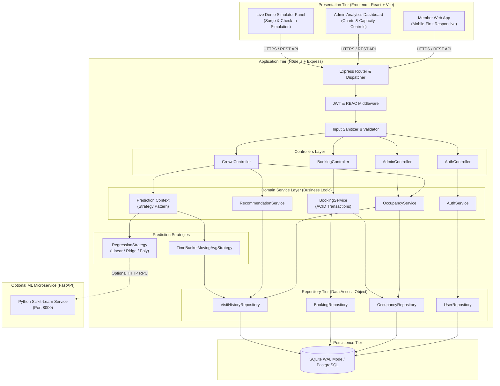
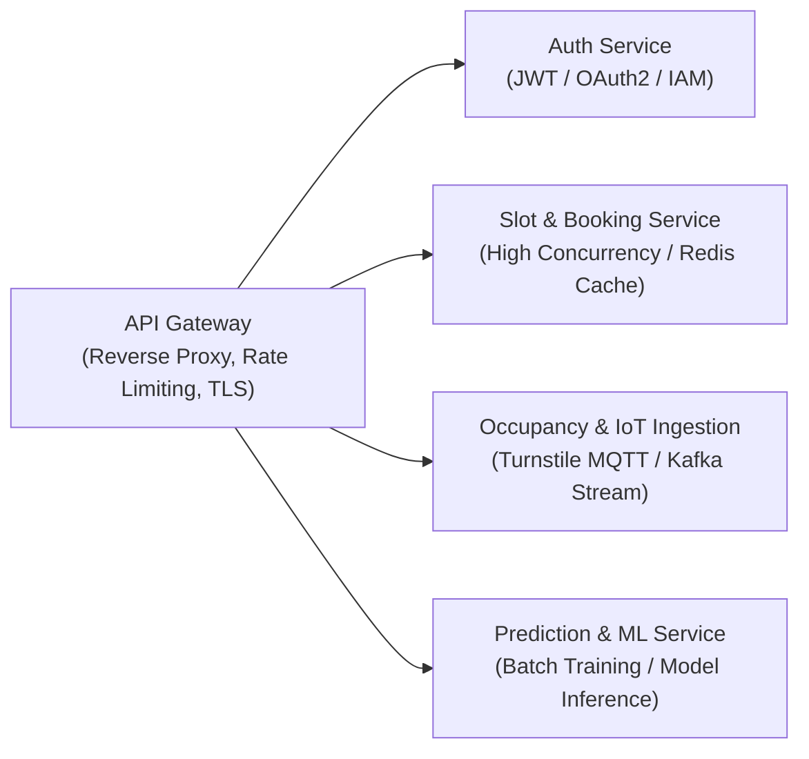
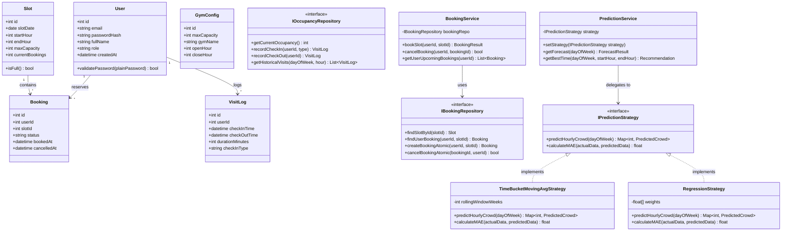
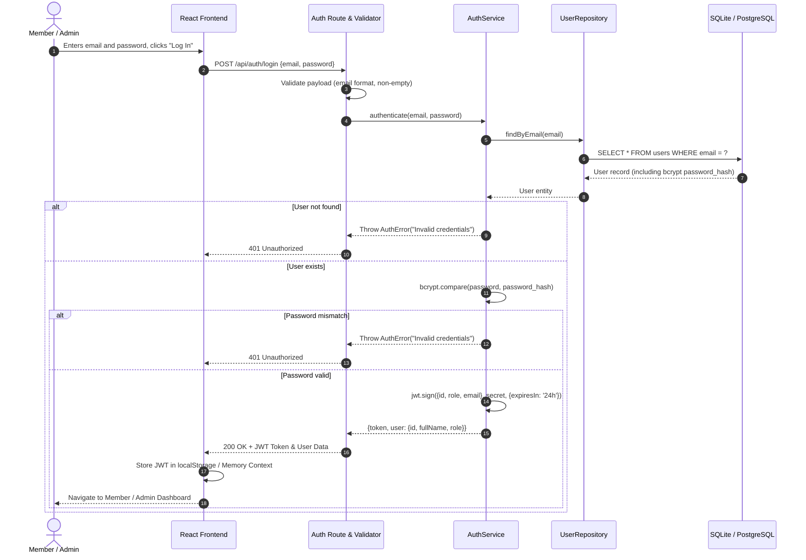
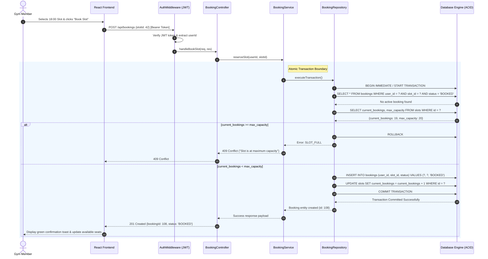
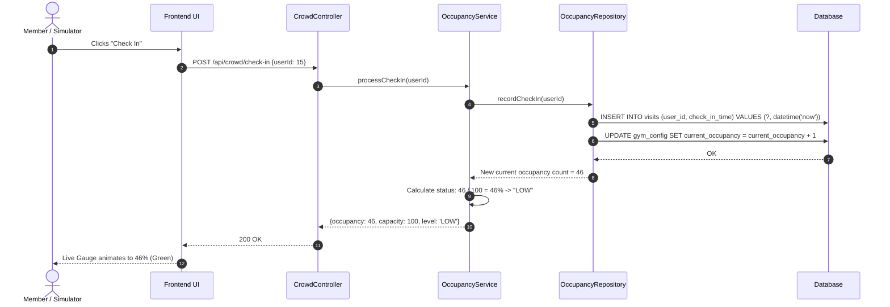
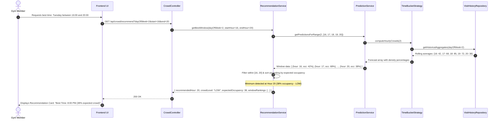
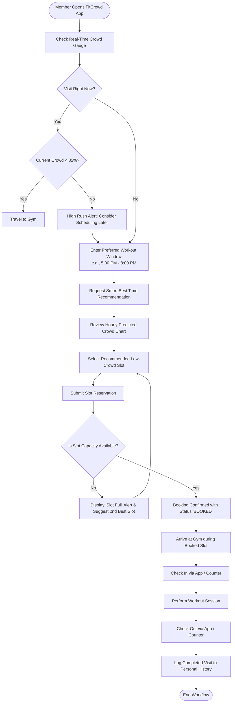
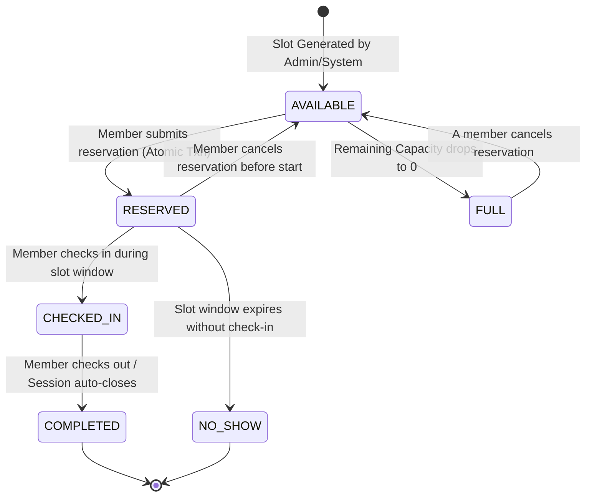
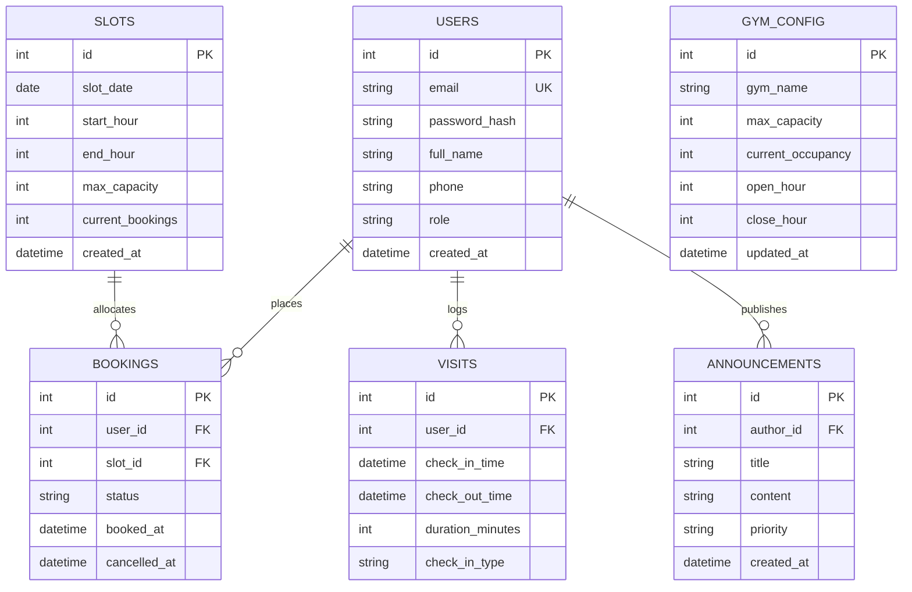

# FitCrowd – Smart Fitness Center Visit Planner
# System Design & Architectural Specification

**Document Version:** 1.0.0  
**Prepared For:** Academic Evaluation & Capstone Review  
**Course:** Software Engineering & System Design (SESD)  
**Author:** Senior Software Engineer & System Architect (Mentor) & CSE Student (Mentee)  
**Status:** Approved Architectural Baseline  
**Date:** November 2026  

---

## 1. High-Level System Architecture

FitCrowd is architected as a **Modular Layered Architecture (Client-Server)** with clean domain boundaries, designed to operate as a high-cohesion modular monolith for frictionless single-command local demonstration while providing a seamless evolutionary pathway toward microservices.



---

## 2. Architectural Style Justification & Microservices Evolution

### 2.1 Why Layered Modular Monolith for the MVP?
1. **Zero Deployment Friction:** For academic examination and local demonstrations, a student cannot afford orchestration failures, distributed network partitions, or port collision headaches. A layered monolith runs in a single process with zero configuration.
2. **ACID Transaction Guarantees:** Preventing double booking requires transactional atomicity (`BEGIN IMMEDIATE`). In a distributed microservice setup, ensuring this across services requires complex Distributed Sagas or Two-Phase Commit (2PC), introducing unwarranted complexity and latency for a gym management platform.
3. **High Cohesion, Low Coupling:** By strictly enforcing the **Repository Pattern** and **Service Layer boundaries**, our code does not leak database queries into controllers.

### 2.2 Evolutionary Pathway to Microservices
As the fitness center franchise scales to 50+ branches with hundreds of thousands of daily check-ins, the application can naturally decompose along existing service boundaries:



- **IoT Turnstile Ingestion Service:** Receives hardware RFID turnstile events over MQTT or WebSockets and streams them to an Apache Kafka or RabbitMQ event bus.
- **Booking Service:** Operates independently with an in-memory Redis cluster for atomic distributed locking (`Redlock`).
- **Prediction Worker:** Runs on GPU-accelerated Python nodes performing continuous offline retraining of XGBoost or LSTM recurrent neural network models.

---

## 3. Comprehensive UML Diagrams

### 3.1 Class Diagram (Design Patterns & Layered Separation)



---

### 3.2 Sequence Diagrams

#### 3.2.1 Sequence Diagram: User Authentication & JWT Issuance



---

#### 3.2.2 Sequence Diagram: Concurrency-Safe Slot Booking

This diagram demonstrates how FitCrowd resolves race conditions and guarantees zero overbooking using database-level atomic transactions.



---

#### 3.2.3 Sequence Diagram: Real-Time Check-In and Check-Out Flow



---

#### 3.2.4 Sequence Diagram: "Best Time to Visit" Algorithmic Recommendation Pipeline



---

### 3.3 Activity Diagram: Member Workout Planning Lifecycle



---

### 3.4 State Machine Diagram: Booking Lifecycle



---

### 3.5 Entity-Relationship (ER) Diagram & Normalization Analysis



#### Database Normalization Analysis (3NF Verification)
- **First Normal Form (1NF):** All attributes contain atomic, indivisible values. There are no repeating groups or multi-valued columns.
- **Second Normal Form (2NF):** All tables have a designated single surrogate primary key (`id`). All non-key attributes are fully functionally dependent on the primary key, eliminating partial key dependencies.
- **Third Normal Form (3NF):** No transitive dependencies exist. For instance, in the `BOOKINGS` table, `slot_date` and `start_hour` are not duplicated from `SLOTS`; they are referenced cleanly via the foreign key `slot_id`. `GYM_CONFIG` holds global single-row facility parameters rather than denormalizing them across every user record.

---

## 4. Database Schema (DDL) & Indexing Strategy

```sql
-- FitCrowd Production Schema (SQLite / PostgreSQL compatible)

-- 1. Users Table
CREATE TABLE IF NOT EXISTS users (
    id INTEGER PRIMARY KEY AUTOINCREMENT,
    email VARCHAR(255) NOT NULL UNIQUE,
    password_hash VARCHAR(255) NOT NULL,
    full_name VARCHAR(100) NOT NULL,
    phone VARCHAR(20),
    role VARCHAR(20) NOT NULL DEFAULT 'member' CHECK(role IN ('member', 'admin')),
    created_at DATETIME DEFAULT CURRENT_TIMESTAMP
);

-- 2. Gym Configuration & Live State Table (Single-row design pattern)
CREATE TABLE IF NOT EXISTS gym_config (
    id INTEGER PRIMARY KEY CHECK (id = 1),
    gym_name VARCHAR(100) NOT NULL DEFAULT 'FitCrowd Fitness Center',
    max_capacity INTEGER NOT NULL DEFAULT 100,
    current_occupancy INTEGER NOT NULL DEFAULT 0 CHECK(current_occupancy >= 0),
    open_hour INTEGER NOT NULL DEFAULT 6,
    close_hour INTEGER NOT NULL DEFAULT 22,
    updated_at DATETIME DEFAULT CURRENT_TIMESTAMP
);

-- 3. Daily Workout Slots Table
CREATE TABLE IF NOT EXISTS slots (
    id INTEGER PRIMARY KEY AUTOINCREMENT,
    slot_date DATE NOT NULL,
    start_hour INTEGER NOT NULL CHECK(start_hour >= 0 AND start_hour <= 23),
    end_hour INTEGER NOT NULL CHECK(end_hour >= 1 AND end_hour <= 24),
    max_capacity INTEGER NOT NULL DEFAULT 25 CHECK(max_capacity > 0),
    current_bookings INTEGER NOT NULL DEFAULT 0 CHECK(current_bookings >= 0),
    created_at DATETIME DEFAULT CURRENT_TIMESTAMP,
    CONSTRAINT uq_slot UNIQUE (slot_date, start_hour)
);

-- 4. Member Slot Bookings Table
CREATE TABLE IF NOT EXISTS bookings (
    id INTEGER PRIMARY KEY AUTOINCREMENT,
    user_id INTEGER NOT NULL REFERENCES users(id) ON DELETE CASCADE,
    slot_id INTEGER NOT NULL REFERENCES slots(id) ON DELETE CASCADE,
    status VARCHAR(20) NOT NULL DEFAULT 'BOOKED' CHECK(status IN ('BOOKED', 'CHECKED_IN', 'CANCELLED', 'NO_SHOW')),
    booked_at DATETIME DEFAULT CURRENT_TIMESTAMP,
    cancelled_at DATETIME,
    CONSTRAINT uq_user_slot UNIQUE (user_id, slot_id)
);

-- 5. Physical Visit Logs Table (Occupancy & Historical Training Data)
CREATE TABLE IF NOT EXISTS visits (
    id INTEGER PRIMARY KEY AUTOINCREMENT,
    user_id INTEGER REFERENCES users(id) ON DELETE SET NULL,
    check_in_time DATETIME NOT NULL DEFAULT CURRENT_TIMESTAMP,
    check_out_time DATETIME,
    duration_minutes INTEGER,
    check_in_type VARCHAR(30) DEFAULT 'MANUAL_APP' CHECK(check_in_type IN ('MANUAL_APP', 'QR_SCAN', 'SIMULATION', 'ADMIN_COUNTER'))
);

-- 6. Announcements Table
CREATE TABLE IF NOT EXISTS announcements (
    id INTEGER PRIMARY KEY AUTOINCREMENT,
    author_id INTEGER NOT NULL REFERENCES users(id),
    title VARCHAR(200) NOT NULL,
    content TEXT NOT NULL,
    priority VARCHAR(20) DEFAULT 'NORMAL' CHECK(priority IN ('LOW', 'NORMAL', 'URGENT')),
    created_at DATETIME DEFAULT CURRENT_TIMESTAMP
);

-- ========================================================
-- PERFORMANCE INDEXES
-- ========================================================
CREATE INDEX IF NOT EXISTS idx_slots_date_hour ON slots(slot_date, start_hour);
CREATE INDEX IF NOT EXISTS idx_bookings_user_status ON bookings(user_id, status);
CREATE INDEX IF NOT EXISTS idx_bookings_slot ON bookings(slot_id);
CREATE INDEX IF NOT EXISTS idx_visits_checkin ON visits(check_in_time);
CREATE INDEX IF NOT EXISTS idx_visits_checkout ON visits(check_out_time);
```

---

## 5. REST API Specification

### Base URL: `/api`

| Endpoint | Method | Auth | Description | Status Codes |
| :--- | :---: | :---: | :--- | :--- |
| `/auth/register` | `POST` | Public | Register new member | `201 Created`, `400 Bad Request`, `409 Conflict` |
| `/auth/login` | `POST` | Public | Authenticate user & return JWT | `200 OK`, `401 Unauthorized` |
| `/auth/me` | `GET` | Bearer | Get current authenticated user profile | `200 OK`, `401 Unauthorized` |
| `/crowd/live` | `GET` | Public | Get real-time occupancy, capacity & level | `200 OK` |
| `/crowd/predicted` | `GET` | Public | Get 24-hr predicted crowd for day-of-week | `200 OK`, `400 Bad Request` |
| `/crowd/recommend` | `GET` | Bearer | Get best time recommendation for user window | `200 OK`, `400 Bad Request` |
| `/crowd/check-in` | `POST` | Bearer | Record member check-in & increment count | `200 OK`, `400 Bad Request` |
| `/crowd/check-out`| `POST` | Bearer | Record member check-out & decrement count | `200 OK`, `400 Bad Request` |
| `/slots` | `GET` | Bearer | List slots for given date with availability | `200 OK`, `400 Bad Request` |
| `/bookings` | `POST` | Bearer | Atomic reservation of a time slot | `201 Created`, `409 Conflict`, `400 Bad Request` |
| `/bookings` | `GET` | Bearer | List current user's active & past bookings | `200 OK` |
| `/bookings/:id/cancel`| `PATCH`| Bearer | Cancel existing booking & restore capacity | `200 OK`, `404 Not Found`, `403 Forbidden` |
| `/admin/analytics`| `GET` | Admin | Aggregate peak hours, weekly trends, utilization | `200 OK`, `403 Forbidden` |
| `/admin/capacity` | `PATCH`| Admin | Update gym total floor capacity & slot defaults | `200 OK`, `400 Bad Request` |
| `/admin/simulator/surge`| `POST`| Admin | Trigger simulated crowd surge for evaluation | `200 OK` |
| `/admin/simulator/reset`| `POST`| Admin | Reset live occupancy to baseline | `200 OK` |

### Sample JSON Payloads

#### `GET /api/crowd/live` Response
```json
{
  "success": true,
  "data": {
    "currentOccupancy": 42,
    "maxCapacity": 100,
    "occupancyPercentage": 42.0,
    "crowdLevel": "LOW",
    "statusColor": "green",
    "updatedAt": "2026-11-13T16:00:00.000Z"
  }
}
```

#### `GET /api/crowd/recommend?date=2026-11-14&start=17&end=20` Response
```json
{
  "success": true,
  "data": {
    "requestedWindow": {
      "date": "2026-11-14",
      "dayOfWeek": 6,
      "dayName": "Saturday",
      "startHour": 17,
      "endHour": 20
    },
    "bestSlot": {
      "startHour": 19,
      "endHour": 20,
      "timeLabel": "7:00 PM - 8:00 PM",
      "predictedOccupancy": 28,
      "occupancyPercentage": 28.0,
      "crowdLevel": "LOW",
      "availableSlotId": 48
    },
    "rankedAlternatives": [
      { "hour": 17, "predicted": 52, "level": "MEDIUM" },
      { "hour": 18, "predicted": 74, "level": "HIGH" }
    ]
  }
}
```

---

## 6. Crowd Prediction Engine Design

### 6.1 Mathematical Formulation: Time-Bucket Moving Average
Gym attendance exhibits strong **seasonality** tied directly to the day of the week ($d \in [0, 6]$) and the hour of the day ($h \in [6, 22]$). A Monday evening at 18:00 has significantly higher expected attendance than a Monday morning at 11:00 or a Sunday evening at 18:00.

Let $C(w, d, h)$ denote the observed occupancy during week $w$, day of week $d$, and hour $h$.
The moving average prediction for window $W$ (default: previous 4 weeks) is formulated as:

$$\hat{C}(d, h) = \frac{1}{|W|} \sum_{w \in W} C(w, d, h)$$

To give higher influence to more recent weeks, FitCrowd supports an **Exponentially Weighted Moving Average (EWMA)** formulation:

$$\hat{C}_t(d, h) = \alpha \cdot C_t(d, h) + (1 - \alpha) \cdot \hat{C}_{t-1}(d, h)$$
where $\alpha \in [0.2, 0.4]$ is the smoothing factor.

### 6.2 Regression Strategy (Machine Learning Formulation)
For continuous feature modeling, the system maps features $\mathbf{x} = [h, h^2, \text{is\_weekend}, \text{recent\_30min\_trend}]$ to predict expected occupancy $\hat{y}$:

$$\hat{y} = \beta_0 + \beta_1 h + \beta_2 h^2 + \beta_3 D_{\text{weekend}} + \epsilon$$

Quadratic term $h^2$ captures the non-linear inverted U-shape curve of gym attendance peaks.

### 6.3 Evaluation Metric: Mean Absolute Error (MAE)
Accuracy is quantified against ground-truth validation data using MAE:

$$\text{MAE} = \frac{1}{N} \sum_{i=1}^N \left| y_i - \hat{y}_i \right|$$

- **Target Benchmark:** $\text{MAE} \le 5.0\text{ persons}$ across all 1-hour operating buckets.
- **Academic Merit:** MAE is chosen over Mean Squared Error (MSE) because it provides a direct, interpretable metric in units of "number of people" without disproportionately penalizing single anomalous spikes.

### 6.4 Cold-Start Handling Strategy
When a new fitness center is initialized or historical data for a specific bucket is absent ($N = 0$):
1. **Prior Baseline Curve:** The system initializes with an empirically grounded normalized bell curve:
   $$B(h) = \begin{cases} 
   0.65 \cdot C_{\max} & \text{for } h \in [7, 9] \quad (\text{Morning Rush}) \\
   0.30 \cdot C_{\max} & \text{for } h \in [11, 15] \quad (\text{Mid-day Low}) \\
   0.85 \cdot C_{\max} & \text{for } h \in [17, 20] \quad (\text{Evening Peak}) \\
   0.20 \cdot C_{\max} & \text{otherwise}
   \end{cases}$$
2. **Bayesian Blending:** As new visit logs are recorded, the prediction dynamically blends the prior baseline with observed data:
   $$\hat{C}_{\text{blended}} = \left(1 - \frac{N}{K}\right) B(h) + \left(\frac{N}{K}\right) \bar{C}_{\text{observed}}$$
   where $K = 14$ days is the threshold after which purely empirical data takes full precedence.

---

## 7. Scalability, Concurrency, Caching & Security

### 7.1 Concurrency & Overbooking Elimination (Zero-Overbooking Guarantee)
In high-demand fitness centers, popular evening slots can sell out in fractions of a second. If multiple concurrent requests read `current_bookings = 19` for a `max_capacity = 20` slot, all might execute an `INSERT`, pushing the count to 23 (Time-of-Check to Time-of-Use / TOCTOU anomaly).

FitCrowd guarantees zero overbooking via a three-tier defense:
1. **Atomic Transaction Isolation (`BEGIN IMMEDIATE` in SQLite / `SELECT ... FOR UPDATE` in PostgreSQL):**
   Prevents concurrent read-write interleaving on the slot record.
2. **Conditional Atomic Update Query:**
   ```sql
   UPDATE slots 
   SET current_bookings = current_bookings + 1 
   WHERE id = :slotId AND current_bookings < max_capacity;
   ```
   If the rows affected is $0$, the slot has already been claimed by a rival transaction; the application immediately aborts and returns HTTP 409 Conflict.
3. **Database Unique Compound Constraint:**
   `CONSTRAINT uq_user_slot UNIQUE (user_id, slot_id)` prevents the same member from booking multiple times even if they double-click rapidly.

### 7.2 Security Architecture & OWASP Defense
- **SQL Injection Prevention:** 100% of queries use parameterized bindings (`db.prepare('... WHERE id = ?').run(id)`). Zero dynamic string concatenation.
- **Cross-Site Scripting (XSS):** React automatically escapes JSX expressions. HTTP response headers set `Content-Security-Policy` and `X-Content-Type-Options: nosniff`.
- **Stateless Authorization (Broken Object Level Authorization - BOLA):** In all booking cancellation and profile endpoints, the query filters by `user_id` extracted from the verified JWT payload, preventing IDOR (Insecure Direct Object Reference) attacks.
- **Cryptographic Hashing:** Passwords hashed with `bcryptjs` using a minimum salt rounds factor of 10.

---

## 8. Design Patterns Catalog

| Pattern | Where Used in FitCrowd | Concrete Purpose & Academic Value |
| :--- | :--- | :--- |
| **Repository Pattern** | `backend/src/repositories/*` | Decouples SQL database queries from business rules in services; enables swapping SQLite for PostgreSQL without touching domain logic. |
| **Strategy Pattern** | `backend/src/services/prediction/*` | Defines an interchangeable family of prediction algorithms (`TimeBucketStrategy`, `RegressionStrategy`), conforming to `IPredictionStrategy`. |
| **Singleton Pattern** | `backend/src/models/db.js` | Ensures exactly one shared database connection pool exists across the application lifecycle. |
| **Middleware Pattern** | `backend/src/middlewares/*` | Intercepts HTTP requests for centralized JWT extraction, schema validation, and RBAC authorization. |
| **Factory Pattern** | `backend/scripts/seedData.js` | Generates realistic synthetic visit entities based on day-of-week probability distributions. |

---

*End of System Design Specification (Phase 3).*  
*Next Stage: Phase 4 – Implementation (Sprints 1 to 4).*
